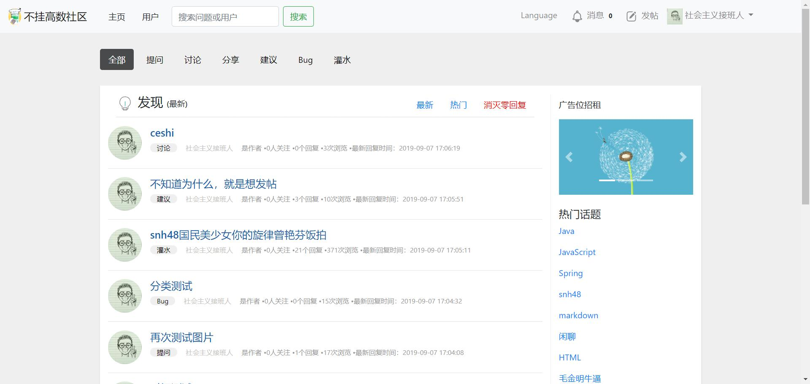
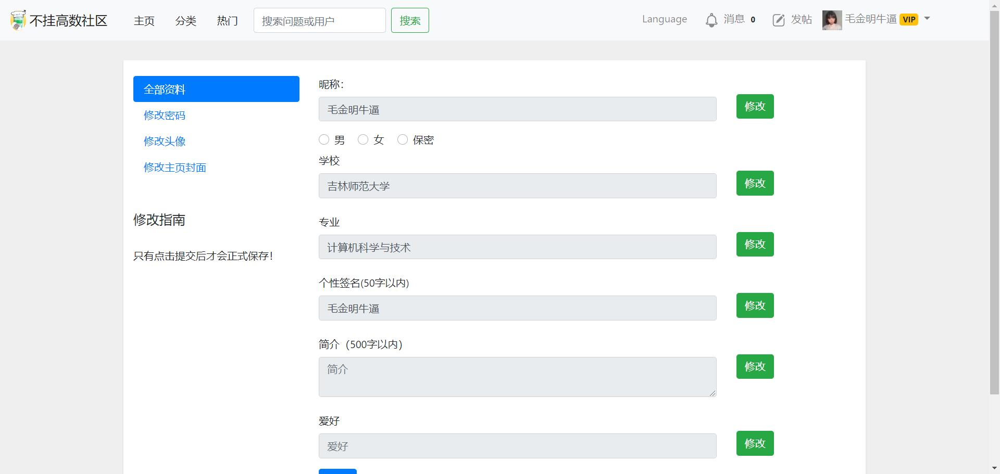
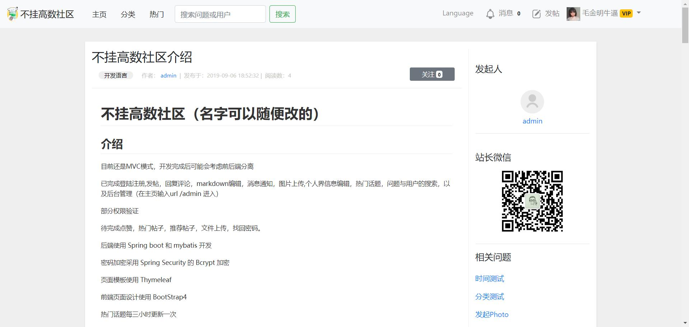
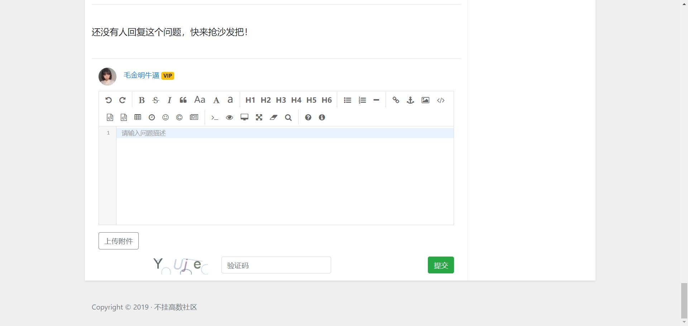
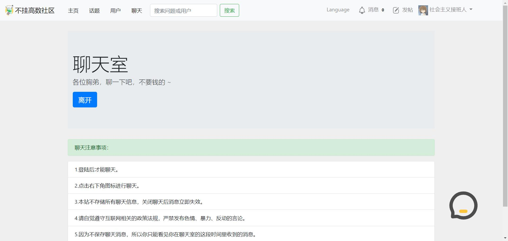
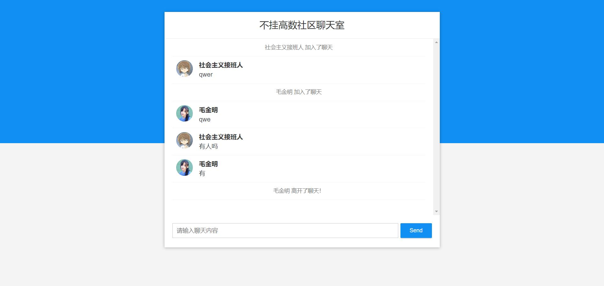
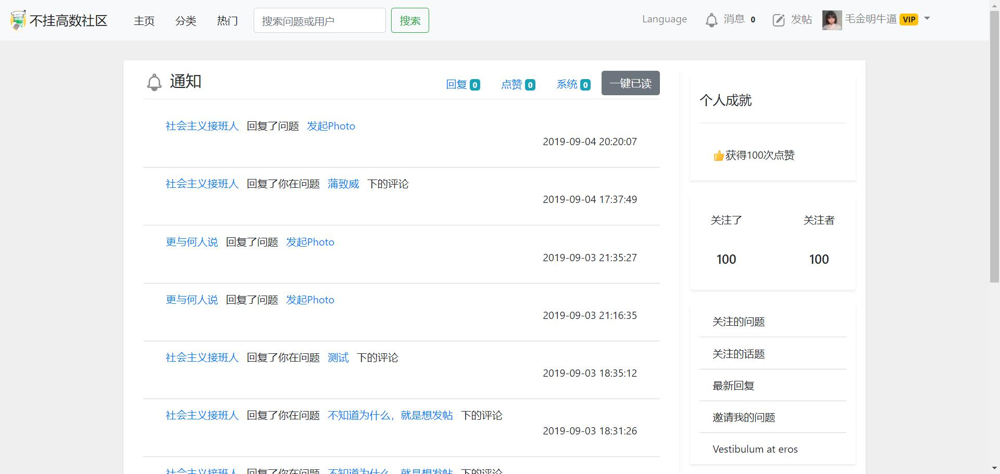
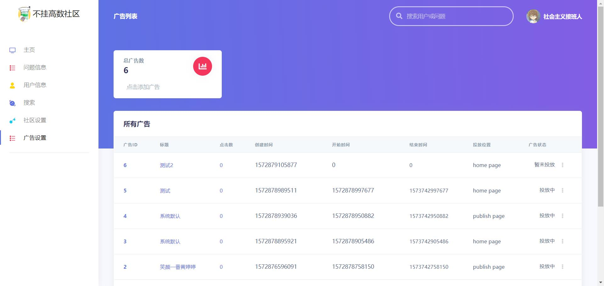

# 不挂高数社区（名字可以随便改的）

## 参考项目

[mawen 社区](http://www.mawen.co)

[community](https://github.com/codedrinker/community)

## 在线访问

https://community.buguagaoshu.com/

## 介绍

目前还是 MVC 模式（Thymeleaf 服务端渲染），后续可能会考虑前后端分离。

已完成登录注册、发帖、回复评论、点赞、Markdown 编辑、消息通知、图片与文件上传、个人资料编辑、热门话题、问题与用户的搜索、热门帖子与话题，以及后台管理（在主页输入 URL `/admin` 进入）——设置首页置顶问题、管理社区、远程查看日志、系统设置等。

部分权限验证，关注用户、话题以及问题。

**还有一个简单的在线聊天室**（WebSocket / STOMP + SockJS）。

待完成：找回密码、删除未使用图片。

### 技术栈（2026-11-15 后端全量升级后）

| 层 | 实现 |
| --- | --- |
| 运行时 | Java 25、Spring Boot 4.1.2（Spring Framework 7 / Jakarta EE 11 / Tomcat 11） |
| Web | Spring MVC + Thymeleaf 3.1、Spring WebSocket |
| 持久层 | MyBatis 注解式 Mapper、MySQL Connector/J 9.7.0、HikariCP 连接池 |
| 会话与缓存 | Spring Session + Redis（Jackson 3 JSON 序列化）、热门数据定时缓存 |
| 对象存储 | AWS SDK v2 S3（兼容 MinIO 等 S3 服务） |
| 安全 | BCrypt 密码加密、JJWT 0.13.0、项目内自研图形验证码 |
| 前端 | Bootstrap 4、Vditor 等静态资源（本轮未升级） |

密码加密沿用 Spring Security 的 Bcrypt 实现（项目内自带工具类）。

热门话题与热门问题每一小时更新一次，每两小时处理一次离线用户，每六小时同步一次管理数据。

> 完整的更新记录见 [CHANGELOG.md](CHANGELOG.md)。


## 快速运行

你可以选择到 releases 中下载直接运行，或者自己打包。不管怎样，都需要先使用 `databases.sql` 脚本创建数据库，并配置 `application.yml`。

### 环境准备

- **Java 25**（Spring Boot 4 最低要求 Java 17，本项目按 Java 25 构建）
- **Maven 3.9+**
- **MySQL 8+ 或 MariaDB**，字符集请使用 `utf8mb4`，以便支持 emoji，不然插入 emoji 时会异常
- **Redis**（Spring Session 依赖；默认配置不带密码，如服务端设置了密码请配置 `spring.data.redis.password`）
- **S3 兼容对象存储**（AWS S3 或 MinIO，修改 `application.yml` 里的 `s3.*` 参数）

> 项目默认使用 MySQL，不再附带 H2 示例依赖。如需改用其他数据库，请自行在 `pom.xml` 中添加对应驱动。

### 打包与运行

1. 使用 `databases.sql` 脚本创建数据库；
2. 配置 `application.yml` 中的数据源、Redis 与 S3 参数；
3. 运行打包命令：

```bash
mvn clean package
```

4. 运行项目：

```bash
java -jar target/community-0.0.1-SNAPSHOT.jar
```

即可。

**注意：**

- **第一个管理员账号**需要在创建完数据库、运行项目并注册第一个账户后，手动将数据库权限表 `power` 列的数据改为 `0`。
- 第一次运行如果没有修改配置文件中上传图片保存路径与日志路径，系统会默认在程序运行的目录下创建 `file` 文件夹和 `log` 文件夹，分别保存图片文件和日志文件。
- 也可以在 IDEA 中导入此项目；如果 getter 和 setter 飘红，需要安装 IDEA 的 Lombok 插件并启用注解处理。JDK 23+ 下 Maven 已通过 `annotationProcessorPaths` 显式配置 Lombok，命令行构建无需额外操作。

## 页面展示

(ps：如果图片不显示，请到images文件夹下查看)

主页



用户首页


用户信息修改页




问题展示页






群聊页





消息提醒页



管理员页面



.jpg)

.jpg)


## 资料
[spring 入门指南](https://spring.io/guides)

[spring boot 文档](https://docs.spring.io/spring-boot/reference/)

[spring boot 日志](https://docs.spring.io/spring-boot/reference/features/logging.html)

[spring thymeleaf 快速指南](https://spring.io/guides/gs/serving-web-content/)

[mybatis 文档](http://www.mybatis.org/mybatis-3/zh/index.html)

[mybatis-spring-boot-autoconfigure](http://www.mybatis.org/spring-boot-starter/mybatis-spring-boot-autoconfigure/)

[Java web开发基础](http://jinxuliang.com/course/CoursePortal/Details/5a9268a9a664d72f041e0a6a)

[BootStrap4 中文文档](http://bs4.ntp.org.cn/)

[Spring Session 参考文档](https://docs.spring.io/spring-session/reference/)

[一个websocket-chat-demo](https://github.com/callicoder/spring-boot-websocket-chat-demo)

[AWS SDK for Java 2.x 开发者指南](https://docs.aws.amazon.com/sdk-for-java/latest/developer-guide/home.html)

[MinIO 官方文档（S3 兼容服务）](https://docs.min.io/cn/)

## 工具
在线 markdown 编辑器 [markdown edit](https://pandao.github.io/editor.md/)

[Vditor](https://hacpai.com/article/1549638745630)

JavaScript剪裁图片工具 [cropperjs](https://github.com/fengyuanchen/cropperjs)

JavaScript定位引擎 [popper.js](https://github.com/FezVrasta/popper.js)

BootStrap 日历选择插件 [Tempus Dominus](https://tempusdominus.github.io/bootstrap-4/)

节省多余的Java代码 [Lombok](https://www.projectlombok.org)

图形验证码：项目内自研模块（`captcha/ImageCaptcha.java` 与 `captcha/CaptchaUtil.java`），使用 `SecureRandom` 生成随机数，规避旧版 EasyCaptcha / kaptcha 的 [CVE-2018-18531](http://www.cnnvd.org.cn/web/xxk/ldxqById.tag?CNNVD=CNNVD-201810-1111) 问题；不再依赖 `libs/EasyCaptcha-1.5.0-RELEASE.jar`

JWT验证工具 [JJWT Java JWT](https://github.com/jwtk/jjwt)（0.13.0）

## 代码文件结构

cache 缓存

captcha 自研图形验证码模块（生成器 + 会话校验工具）

component 组件

config 自定义配置（含 S3 客户端、S3 属性、会话序列化、WebSocket）

controller 控制层

dto DAO层负责页面与后端程序的数据传输

enums 各种数据的类型

exception 异常处理

interceptor 过滤器

mapper 数据库映射

model 定义数据库和后端程序的数据交换类型

repository 对象存储仓库接口及 AWS SDK v2 S3 实现

schedule 定时任务

service 服务层

util 各种工具

## 更新日志

完整的更新历史已归档到 [CHANGELOG.md](CHANGELOG.md)，包含 2026-11-15 的后端全量升级记录（Spring Boot 4.1.2 / Java 25、Jakarta 迁移、HikariCP、自研验证码、AWS SDK v2 S3）以及 2019–2020 年的历次更新。
