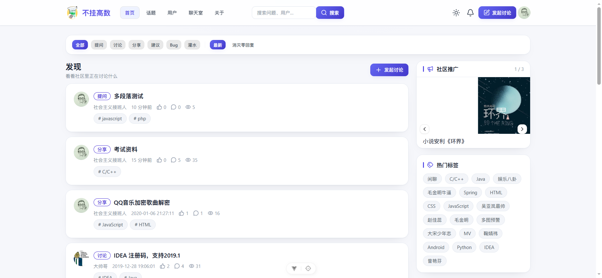
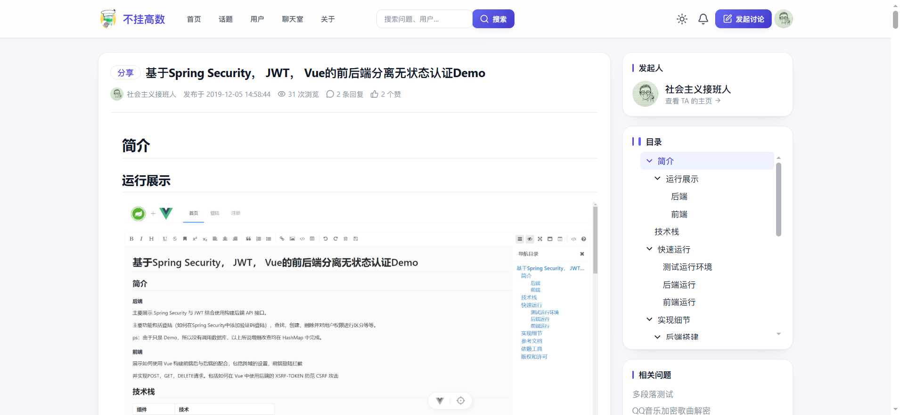
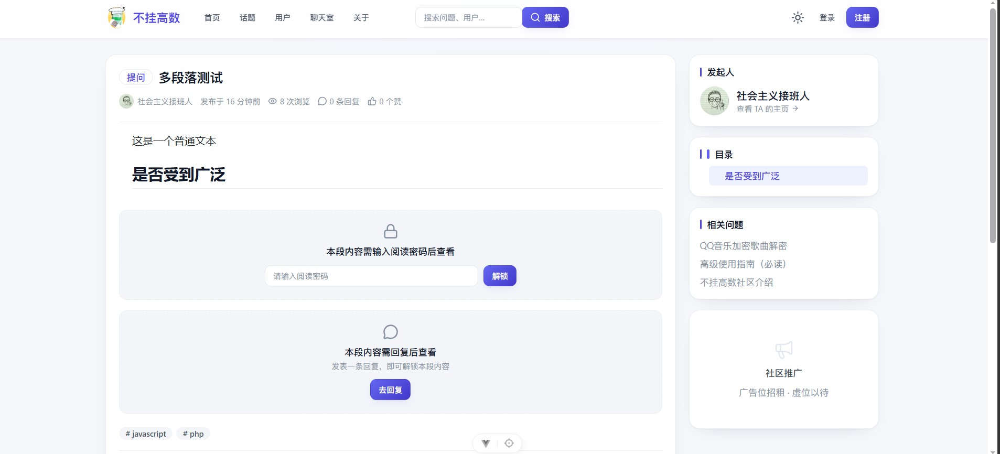
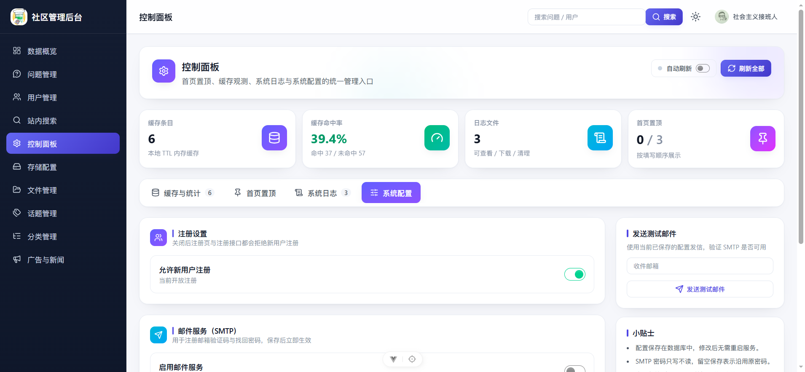

# 不挂高数社区

[](https://openjdk.org/)
[](https://spring.io/projects/spring-boot)
[](https://vuejs.org/)
[](https://www.mysql.com/)
[](LICENSE)

一个**前后端分离、可私有化部署**的现代开发者社区：提问、讨论、分享，话题（吧）体系，私有话题与内容级可见性控制，审核 / 举报 / RBAC 权限，站内通知，Markdown 富文本，以及带数据看板的管理后台。

- 在线体验：<https://community.buguagaoshu.com/>
- 源码仓库：<https://github.com/PuZhiweizuishuai/community>
- 更新记录：[CHANGELOG.md](CHANGELOG.md)
- 前端说明：[web/README.md](web/README.md)

## 为什么值得一试

- **真正的私有话题**：话题支持「公开 / 私有可申请 / 私有仅邀请」三级可见性，帖子内容仅成员可见；私有隐藏话题对非成员按 404 处理，首页、搜索、榜单也不会泄露标题与存在性。
- **内容也能分级可见**：单篇帖子可选「公开 / 登录可见」，正文还能拆成「普通 / 密码可见 / 回复可见」段落，适合资料分享、课程答疑、付费内容等场景。
- **完整的社区闭环**：发布 → 审核 → 互动（评论 / 点赞 / 关注）→ 通知 → 举报 → 处置 → 申诉重提，全部在站内完成。
- **像「贴吧」一样运营**：每个话题都有吧主与吧务，可审批加入、邀请成员、置顶、加精、改标签、删帖恢复，管理员只负责平台级治理。
- **生产级安全基线**：CSP / HSTS 等安全响应头、登录双维度限流与防枚举、文件头（魔数）校验、后台接口默认拒绝、封禁拦截、日志脱敏。
- **开箱即用的后台**：数据概览、用户 / 内容 / 评论 / 审核 / 举报、RBAC 角色权限、话题与分类、广告位、S3 存储、缓存与系统开关，均可视化配置。

## 界面预览

### 首页



### 内容页





### 管理后台



## 核心功能

### 话题（吧）与私有空间

话题是社区的内容组织单元，聚合简介、成员、吧务团队与帖子列表，支持关注、分类与活动统计。

| 可见性 | 话题信息 | 帖子内容 | 加入方式 |
| --- | --- | --- | --- |
| 公开 | 所有人可见 | 所有人（受帖子可见性约束） | 登录后可直接发帖 |
| 私有 · 可申请 | 所有人可见，带私有标识 | 仅成员 / 吧务 / 创建者 / 管理员 | 提交申请，吧务审批 |
| 私有 · 仅邀请 | 仅成员 / 吧务 / 创建者 / 管理员 / 待接受邀请者 | 同上 | 只能由吧务邀请 |

- 创建话题默认需要 `content:topic:create` 权限，提交后进入审核，通过才公开展示；吧主可修改简介、图标与可见性。
- 成员体系：申请加入、邀请加入、审批、移除、取消邀请；吧主可设置吧务。
- 吧务操作：置顶、加精、修改标签、删除 / 恢复帖子。
- 私有话题的隔离覆盖详情页、列表、搜索、首页置顶与热门榜单，避免通过 ID 枚举或缓存快照泄露内容。

### 内容发布与阅读

- 动态内容分类（提问 / 讨论 / 分享 / 建议 / Bug / 灌水），后台可增删改排序，无需改代码。
- 每篇帖子绑定一个话题，最多 5 个标签，标签经审核后才进入公共标签库。
- 正文分段可见性：普通段落、密码可见段落（阅读密码解锁）、回复可见段落（评论后解锁）。
- Markdown 编辑与渲染（Vditor）、代码高亮、正文目录（TOC）、图片 / 附件上传、头像与封面 Canvas 裁剪。
- 帖子级可见性：公开或登录可见；登录可见帖对匿名用户只展示标题。
- 浏览 / 点赞 / 关注 / 评论计数，浏览量经缓冲批量落库，降低数据库压力。

### 社区互动

- 两级评论、评论排序、点赞、关注问题 / 用户 / 话题。
- 站内通知：回复、点赞、帖子删除与恢复、审核结果、举报处理结果等。
- 内容举报：按原因分类提交，后台受理或驳回，结果回传举报人。
- 个人主页：动态、关注的问题 / 话题 / 用户、粉丝，并提供 4 个独立隐私开关，隐藏后对其他访问者不可见。

### 内容审核

- 全站审核总开关：关闭时内容直接发布，开启后问题与评论进入待审核区。
- 后台可通过或驳回，填写驳回原因与修改意见；作者在「我的审核」查看并修改后重新提交。
- 每次提交 / 通过 / 驳回均写入审核流水，支持追溯；管理员审核时可看到密码 / 回复可见段落。

### 实时聊天室

- SockJS + STOMP，按用户占用单窗口席位，同一账号不会多端重复在线。
- 消息支持 Markdown 渲染、日期分隔、5 分钟内的连续消息合并、在线成员列表。
- 输入区支持 Enter 发送、Shift + Enter 换行、Ctrl/⌘ + Enter 发送，兼容中文输入法组合态。
- 后台可一键关闭聊天室，前台入口与 WebSocket 握手同步失效。

### 管理后台

- **数据概览**：评论 / 话题 / 分类 / 文件 / 存储占用 / 封禁用户 / 广告 / 待审内容 / 举报 / 缓存命中率。
- **用户管理**：搜索、角色分配、临时或永久封禁与解封、登录历史、重置密码。
- **内容治理**：问题管理、评论管理、内容审核、举报处理，均带筛选、详情弹窗与分页。
- **运营配置**：话题管理、标签审核、动态分类、广告与新闻（多广告位、定时上下线、批量操作）。
- **系统能力**：RBAC 角色权限、存储配置（S3 / MinIO，支持连通性测试）、文件管理、首页置顶、缓存刷新、日志下载、SMTP 邮件测试、注册 / 聊天 / 审核开关。

## 技术架构

前后端完全分离：`src/` 只提供 `/api/**` JSON 接口，`web/` 是独立的 Vue 3 单页应用。

```
┌──────────────────────────┐   /api    ┌───────────────────────────┐
│  web/  Vue 3 SPA         │ ────────► │  Spring Boot 4 REST API   │
│  Vite · Pinia · Vditor   │   /ws     │  Controller → Service     │
│  daisyUI · Tailwind      │ ◄──────── │  → MyBatis-Flex Mapper    │
└──────────────────────────┘  SockJS   └─────────────┬─────────────┘
                                                     │
             ┌───────────────┬───────────────┬───────┴────────┐
          MySQL 8          Redis         S3 / MinIO       SMTP 邮件
        （业务数据）  （会话·限流·缓存） （图片·附件）  （验证码·重置密码）
```

| 层 | 实现 |
| --- | --- |
| 后端 | Java 21+（Docker 镜像基于 JDK 25）、Spring Boot 4.1.2、Spring MVC、Spring WebSocket / STOMP |
| 持久层 | MyBatis-Flex 1.11.8、MySQL 8、HikariCP、Flyway 版本化迁移 |
| 会话与权限 | Spring Session + Redis、自研 RBAC（角色 / 权限点 / `@RequirePermission`）、JWT「记住我」 |
| 文件存储 | AWS SDK for Java v2（S3 协议，兼容 MinIO），存储参数在后台维护 |
| 安全 | BCrypt、图形验证码、CSP / HSTS 等安全响应头、登录限流、文件魔数校验 |
| 前端 | Vue 3、Vite 8、Vue Router、Pinia、daisyUI 5 / Tailwind CSS 4、Vditor 4、ECharts 6 |
| 通信 | 统一 fetch 组件 → `/api/**`；SESSION cookie 维持登录态；聊天走 SockJS + STOMP `/ws` |

关键设计：

- **统一响应体** `{ status, message, timestamp, data }`，401 / 403 / 404 与业务错误码一致，前端只需处理一种失败形态。
- **全站统一缓存** `SiteCacheService`：热门问题 / 标签 / 用户、分类、话题、首页列表按 TTL 缓存，写操作精确失效，后台可查看命中率。
- **安全默认拒绝**：`/api/admin/**` 未声明权限点即要求 `admin:access`，新增后台接口必须显式授权。
- **数据库变更**：新库由 Flyway 全量建表，旧库自动从 V4 补齐；数据修复类脚本单独放在 `SQL_Upgrade/`。

## 快速开始

### 环境要求

- JDK 21+（推荐 25）
- Maven 3.9+
- Node.js 22.18+ / 24.12+
- MySQL 8+、Redis 7+
- S3 兼容对象存储（MinIO 即可，也可启动后在后台配置）

### 1. 启动依赖服务

```bash
# MySQL + Redis + MinIO（MySQL 首次启动会导入 databases.sql 与 001/002，等价于 Flyway V1~V3）
docker compose up -d mysql redis minio
```

已有 MySQL / Redis 可跳过此步（MySQL 需先创建 `utf8mb4` 编码的 `community` 库）。对象存储也可以稍后在后台「存储配置」中填写。

### 2. 配置后端

```bash
cp src/main/resources/application-example.yml src/main/resources/application-local.yml
```

至少填写 `MYSQL_PASSWORD`、`REDIS_PASSWORD`、`JWT_KEY`（≥ 32 字节随机值，可用 `openssl rand -base64 48` 生成）。也可以不建本地文件，直接用同名环境变量注入。

### 3. 启动

```bash
# 后端：http://localhost:8080（只提供 JSON API，Flyway 自动建表 / 升级）
mvn spring-boot:run

# 前端：http://localhost:5173
cd web
npm install
npm run dev
```

Vite 已把 `/api`、`/file`、`/image`、`/captche`、`/adUrl`、`/ws` 代理到后端，开发阶段同源，登录态可直接携带。

### 4. 创建第一个管理员

先在前台注册账号，再把它加入内置「超级管理员」角色（把邮箱换成自己的账号）：

```sql
INSERT INTO sys_user_role (userId, roleId)
SELECT u.id, r.id FROM users u JOIN sys_role r ON r.code = 'super_admin'
WHERE u.email = 'you@example.com';
```

之后从 `/admin/login` 进入后台。新用户注册会自动获得「社区成员」角色（发布问题、评论、上传文件），该角色的权限可在后台「角色权限」中动态调整。

## 部署

### 前后端分离部署

```bash
cd web && npm run build          # 产物在 web/dist
```

把 `web/dist` 交给 Nginx / 静态服务器，构建时用 `VITE_API_BASE`、`VITE_ASSET_BASE` 指向后端地址，并把前端域名写入后端 `APP_CORS_ALLOWED_ORIGINS`。

### 打成单个 Jar

```bash
cd web && npm run build
cp -r dist/* ../src/main/resources/static/
cd .. && mvn clean package
java -jar target/community-0.0.1-SNAPSHOT.jar
```

后端内置 SPA 路由回退，刷新 `/question/1`、`/admin/users` 等深链接不会 404。

### Docker

```bash
docker compose --profile app up -d --build
```

镜像构建只包含后端编译，不包含前端构建步骤。若希望页面随 Jar 一起发布，先按上一节把 `web/dist` 复制到 `static/` 再执行构建；否则用 Nginx 单独托管前端。生产建议 `SPRING_PROFILES_ACTIVE=prod`，由 Nginx 终止 HTTPS 并传递 `X-Forwarded-Proto` / `X-Forwarded-For`。

### 常用环境变量

| 变量 | 说明 |
| --- | --- |
| `MYSQL_USERNAME` / `MYSQL_PASSWORD` | 数据库账号（`application.yml` 内配置 JDBC URL） |
| `REDIS_HOST` / `REDIS_PORT` / `REDIS_PASSWORD` | Redis 连接，生产必须设置密码 |
| `JWT_KEY` | 「记住我」签名密钥，≥ 32 字节；轮换后旧 token 全部失效 |
| `COOKIE_SECURE` | HTTPS 部署时设为 `true`，SESSION 与 token cookie 才会带 Secure |
| `APP_CORS_ALLOWED_ORIGINS` | 允许的前端来源，逗号分隔，禁止 `*` |
| `TRUSTED_PROXIES` | 可信反向代理地址，仅这些来源的 `X-Forwarded-For` 会被采信 |
| `FRONTEND_BASE_URL` | 找回密码邮件中的前端链接前缀 |
| `MAIL_HOST` / `MAIL_PORT` / `MAIL_USERNAME` / `MAIL_PASSWORD` / `MAIL_ENABLED` | SMTP 邮件；未配置时自动关闭邮件能力 |
| `SECURITY_CSP_ENABLED` / `SECURITY_CSP` | 安全响应头总开关与自定义 CSP |
| `SPRINGDOC_ENABLED` | 接口文档开关，`prod` profile 默认关闭 |

## 数据库与升级

- **全新安装（推荐）**：创建一个 `utf8mb4` 编码的空库，启动应用即可，Flyway 会从 `V1` 依次建表并初始化到最新版本，不需要手工导入任何 SQL。
- **使用 docker compose**：MySQL 容器首次启动会导入 `databases.sql` 与 `SQL_Upgrade/001`、`002`（等价于 V1~V3），应用启动后由 Flyway 自动补齐 `V4` 及以后版本。
- **已有旧库**：先执行 [`SQL_Upgrade/001_performance_and_consistency.sql`](SQL_Upgrade/001_performance_and_consistency.sql) 与 [`002_unique_constraints.sql`](SQL_Upgrade/002_unique_constraints.sql)（均幂等，含索引 / 唯一约束 / 字符集优化），再启动应用让 Flyway 从 `V4` 自动补齐；回滚脚本在同目录。
- **数据修复脚本**（按需手动执行，均含预览、留底与回滚）：
  - [`003_migrate_all_questions_to_topic.sql`](SQL_Upgrade/003_migrate_all_questions_to_topic.sql)：历史帖子归入话题。
  - [`004_fix_nested_file_urls.sql`](SQL_Upgrade/004_fix_nested_file_urls.sql)：修复重复拼接的文件链接。

> 数据库结构以 `src/main/resources/db/migration/` 下的 Flyway 脚本为准；`databases.sql` 是历史完整导出，仅用于容器首次初始化。

## 目录结构

```
src/main/java/com/buguagaoshu/community/
  controller/api/   所有 REST 接口（前台 + 后台）
  service/          业务逻辑（话题权限、审核、举报、缓存等）
  mapper/           MyBatis-Flex Mapper
  model/ dto/       数据模型与传输对象
  config/           跨域、会话、S3、WebSocket、安全响应头
  interceptor/      权限、封禁、记住我恢复
  cache/            热搜、热门标签、话题等内存快照
src/main/resources/
  db/migration/     Flyway 迁移脚本
  application*.yml  配置与凭据模板
web/src/
  api/              统一 fetch 组件与接口清单
  router/ stores/   路由守卫与 Pinia 状态
  components/       通用 UI、编辑器、Markdown、目录、裁剪等
  views/            前台页面；views/admin 为后台
SQL_Upgrade/        旧库升级与数据修复脚本
docs/               安全审计、性能优化等设计文档
```

## 文档

- [更新日志](CHANGELOG.md)
- [前端运行与接口约定](web/README.md)
- [后端安全审计与优化方案](docs/后端安全审计与优化方案.md)
- [后端数据库性能优化方案](docs/后端数据库性能优化方案.md)
- 接口文档：启动后访问 `/swagger-ui/index.html`（生产默认关闭）

## 贡献与许可

欢迎提交 Issue 与 Pull Request。提交前请确认后端测试（`mvn test`，需可用的 MySQL / Redis）与 `web` 下的 lint / build 通过。

基于 [MIT License](LICENSE) 开源。项目参考了 [mawen 社区](http://www.mawen.co) 与 [codedrinker/community](https://github.com/codedrinker/community) 的设计思路。
